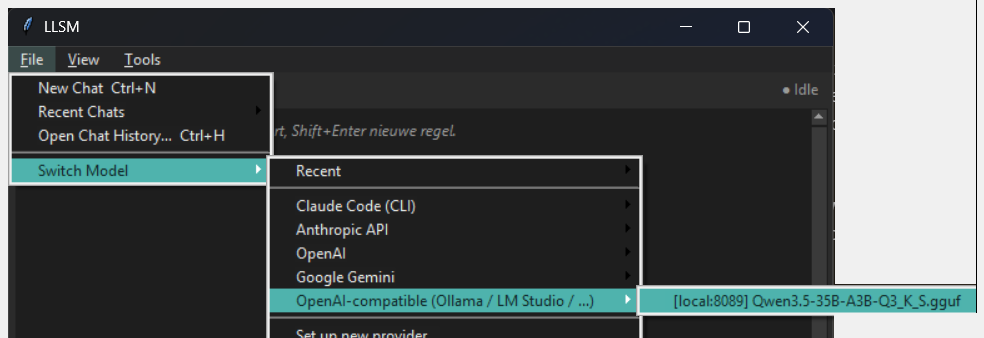

# Local models: picked from the menu, tools on, measured

Date: 2026-11-25. Machine: RTX 5000 Ada laptop GPU (16 GB), llama-server (llama.cpp, CUDA) serving
the OpenAI-compatible API. Script: `scripts/local_model_trial.py`.

## Answer

- **A 35B model builds simple beam models correctly through LLSM's local route.**
  Qwen3.5-35B-A3B (Q3_K_S, ~15 GB): in 17 of 18 runs the built model passed every check, and 16
  of 18 also ended with a final answer. The misses: one beam clamped at both ends instead of on two
  supports, and one run that built a correct portal frame and then stopped without a final answer.
- **A 7B model does not.** qwen2.5-7b-instruct (Q4_K_M, ~4.7 GB): 1 of 9 in the first spike. Its tool
  calls are well formed, but the structure is wrong: missing supports, a portal frame lying flat,
  loads pointing up, answers in English.
- **A thinking model used to end the chat with an empty reply halfway.** Cause, captured on the raw
  responses: the model wrote its next tool call *inside its reasoning block*
  (`reasoning_content` ended in `<tool_call><function=add_node>…`), so the server returned
  `finish_reason: "stop"` with empty content and no `tool_calls`, and LLSM took that as the final
  answer. Not a token limit (those turns used 37 and 65 completion tokens). LLSM now asks the model to
  continue (at most twice) and otherwise says plainly that it stopped and after how many tool calls.
  With thinking on this went from 3 of 9 to 8 of 9.
- **The File menu now lists a local server's models.** Before, Switch Model → OpenAI-compatible said
  "(no models available)" until a chat with that provider existed, and you could only get such a chat
  from that menu. Now the server is asked in the background; with a Gemini chat active and nothing sent
  (the colleague's situation) the list appeared 0.33 s after the panel started.

## The trial

Three natural Dutch requests, three runs each, through the real OpenAI-compatible backend with the
SCIA tools a new local chat gets, and the real in-memory model builder. Starting SCIA, pushing and
calculating return a neutral answer (SCIA itself is not measured here). Each run is checked on what
was built: number of nodes, members, supports and loads, span, height, load sign and size, section
size, and the support type (portal: clamped; beam "op twee steunpunten": not clamped at both ends).

```
model                                   thinking  passed  built   median
qwen2.5-7b-instruct Q4_K_M (spike)      n/a        1 / 9   1 / 9   ~25 s
Qwen3.5-35B-A3B Q3_K_S (spike, before)  on         3 / 9   3 / 9   ~30 s
Qwen3.5-35B-A3B Q3_K_S (spike)          off        9 / 9   9 / 9   ~30 s
Qwen3.5-35B-A3B Q3_K_S (this build)     on         8 / 9   9 / 9    41 s
Qwen3.5-35B-A3B Q3_K_S (this build)     off        8 / 9   8 / 9    29 s
```

"built" = every check on the model passed; "passed" also needs a final answer. The spike rows used
looser checks (no support type, no height): under them the thinking-off miss of this build (a beam
clamped at both ends) would have passed too, and the spike's own thinking-off runs included two
beams clamped at one end, which the current check also lets through. The largest context any run used
was 4,884 tokens with the 18 tools; the server ran with 12,288.

## The menu, end to end

The real panel, started with an isolated home folder (no change to the owner's settings), a local
server URL saved, and a Gemini chat active with no message sent:

- File → Switch Model → OpenAI-compatible listed the server's model 0.33 s after start
  (`img/local-models-menu.png`).
- Picking it started a new chat on that model with SCIA tools on, not marked unavailable.
- The beam request built 2 nodes, 1 member, 2 supports and a load of −10 kN/m, in 27 s, with a Dutch
  answer (thinking off). With thinking on the same request built the model and then ended with the
  new "stopped without an answer after 11 tool calls" message.
- With the server stopped, the cascade showed "(server not reachable at http://127.0.0.1:8089/v1)"
  2.25 s later. Opening the menu took 16-31 ms and the UI loop answered within 63 ms while the
  background probe waited on the dead port.



## Advice

- Use the 20-30 GB class for driving SCIA. Models of 5-8 GB build wrong models.
- Thinking off is faster (29 s vs 41 s) and steadier. llama-server: `--reasoning off`. How to
  switch it off in Ollama for a given model was not checked here.
- Give the server a context of at least 8,000 tokens; a beam chat reached 4,884. Check what your
  server uses by default (not checked here for Ollama).
- Measure the model you plan to use before relying on it:
  `python scripts/local_model_trial.py --model qwen3-coder:30b` (Ollama's URL is the default).

## Not verified

- Ollama itself, and the colleague's models (qwen3-coder:30b, gpt-oss:20b): no Ollama on this
  machine. The menu talks to any `/v1/models`; the fake-server tests and llama-server cover that.
- The 32-tool set of the Claude Code route: the local route has 18 (no traffic, beddings, report,
  edits).
- Real SCIA push and calculation from a local chat.
- Nine runs per setting is a small sample.
- Gemini against the real service: an empty final turn now gives the same clear message (unit
  test with a fake client), but is not nudged to continue, because the follow-up message shape it
  would need was never sent to Gemini.
