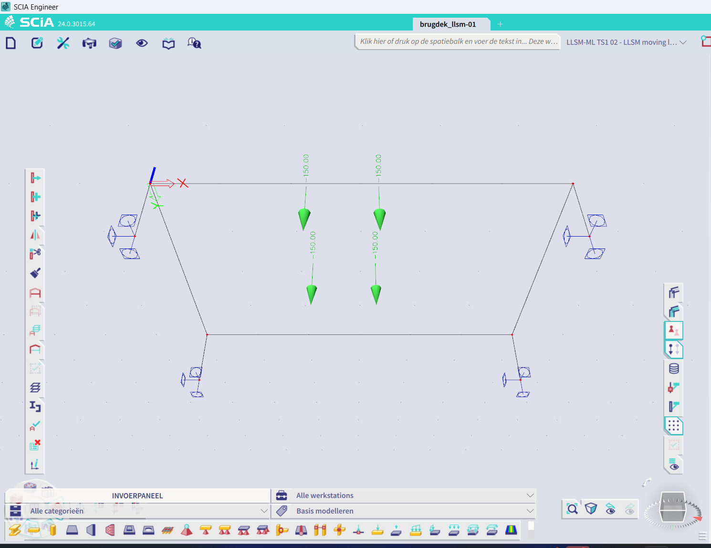

# Phase 3 verification — moving load positions on a saved SCIA model

Date: 2026-11-12. SCIA Engineer 24.0.3015.64, ESA_XML, on copies only. Plan:
`docs/10-plan-moving-load.md`. Scripts: `phase0/moving_load/` (models and logs in the
gitignored `phase0/xml_route/work/` folder).

## Decision

**GO, for plate decks and beam decks.** ESA_XML writes a load group, load cases and point
forces into a saved model in one update; SCIA takes the values as N and m; the forces land
on the plate (the column forces add up to the loads, exactly, and split as the hand
calculation says); and every object reads back from the saved file. One value in an
unrelated table changes on every update (see S5); it is recorded, not explained.

## Test models

- **Plate deck** `plate_base.esa`, built through XML from the kademuur template
  (`make_plate.py`): plate D1, 6000 × 4000 mm, 300 mm, C20/25, at z = 0, on four 1 m
  columns C1–C4 (D 400 mm) with fixed feet. The plan asked for line supports along the
  short edges; columns were used instead because the template's result document exports
  1D internal forces and no reactions: the columns' axial forces are the reactions.
- **Beam** `pile_base.esa` from phase 0: one member B1, (0, 0, 0) to (0, −2.5, −10) m.
- **Real** the kademuur demo model (`kademuur_kaal.esa`, 32 piles, deck E1, wall E2), read
  only, plus a bedding regression on a copy.

## Criteria

| # | Criterion | Result | Evidence |
|---|---|---|---|
| S1 | Group + 3 cases + free point loads in one update | **PASS** | `spike.py s1`: exit 0 in 22 s. SCIA's object log in the saved file: point forces free 0 → 12, load cases 1 → 4, load groups 1 → 2. All 12 names read back. |
| S2 | Units and coordinates | **PASS, by calculation** | Literal −100000 at (1.7, 1.0) is stored as −100000.0 at x 1.7, y 1.0 (reader). That SCIA reads these as N and m follows from S3: in kN the reactions would be 1000× smaller, in mm the loads would miss the plate. In the SCIA GUI each wheel shows as −150.00 kN on the deck (see Screenshot). |
| S3 | Loads land on the plate | **PASS** | `spike.py s3` and `reactions.py` on the product's own output: the 3 cases in one linear combination, calculated (LIN, 33–41 s). Column forces −232.7 / −217.3 / −217.3 / −232.7 kN, sum **900.0 kN = 900.0 kN** of loads read back (ratio 1.0000). Hand: moments of the loads about x = 0 give 2610 kNm, so 435 kN at x = 6 m (217.5 per column) and 465 kN at x = 0 (232.5): matches to 0.2 kN, the rest is the frame action of the fixed columns. |
| S4 | Point load on a beam by name + relative x | **PASS** | `spike.py s4` and `llsm moving-load apply --deck beam --member B1`: stored member id 1, positions 0.25 / 0.75 (spike) and 0 / 0.5 / 1 (product), values −10000 / −20000 N. |
| S5 | Nothing else changed | **PASS, one value unexplained** | `diff_aligned.py` against two plain re-saves (phase 0's index diff cannot handle an added block). Ours: the new free-load block, the group and case blocks. Bookkeeping: a counter 12 → 13, the object log text, the revision history. Results flagged out of date: in the three FE result tables one flag per entry 1 → 0. **Unexplained: in the UCS record ("Huidig UCS") one u32 1012 → 0**, like phase 0's code-manager 100 → 0. Members, nodes, plates and every other load object compare equal in the reader. |
| S6 | Read-back from the saved file | **PASS** | New `read_loads` (`llsm.scia.esa_file`): nodes, plates with outline, load groups (relation, load), load cases (action, their load ids), free and beam point forces (value, x/y or member + position, case id). Every table cross-checked against SCIA's object log; on the real kademuur model too (74 nodes, 2 plates, 6 groups, 8 cases), no format error. |
| S7 | Same name again | **Overwrites** | `spike.py s7`: writing s1's update again with W1 at −123000 on the output: still 12 loads, W1 now −123000. As with supports, a name is a key: the tool refuses existing names unless `replace`, and `replace` only touches names starting with `LLSM-ML `. |
| S8 | Envelope combination | **Written, not in v1** | `spike.py s8`: exit 0, the combination is stored with three coefficients 1.0. The reader does not decode combinations, so it could not be checked after writing; v1 leaves it out. The group is exclusive, so SCIA's own envelope takes one position at a time. |

## Enum values, measured

| Field | Value written | Stored | Read as |
|---|---|---|---|
| Load group, Relation | 1 (spike), 2 (probe) | byte 1 after the name: 1, 2 | 0 standard, 1 exclusive, 2 together |
| Load group, Load | 1 (spike), 0 (probe) | byte 3: 1, 0 | 0 permanent, 1 variable |
| Load case, Action type | 1 (spike), 0 (probe) | byte 3: 1, 0 | 0 permanent, 1 variable |

The meaning of the numbers is confirmed on the real kademuur model: its groups "Verkeer",
"Boom", "IJs" and "Aanmeer" read as variable/standard, "Aanvaring" (collision) as
variable/exclusive, its case "BG6 Var" as variable and "BG6 Perm" as permanent.

## Hand case, end to end through the product

`apply_moving_load` on a copy of the plate deck: axles 200 kN (front) and 100 kN 1200 mm
behind, track 2000 mm, path (500, 2000) → (4900, 2000) mm, step 1600 mm.

| Case | Front axle x (mm) | Rear axle x (mm) | Wheels (kN) | Total (kN) |
|---|---|---|---|---|
| LLSM-ML TS1 01 | 1700 | 500 | 2 × −100 at y 1000 / 3000, 2 × −50 | −300 |
| LLSM-ML TS1 02 | 3300 | 2100 | same | −300 |
| LLSM-ML TS1 03 | 4900 | 3700 | same | −300 |

Result: 12 of 12 loads and 3 of 3 cases confirmed from the saved file (value exact, x and y
within 0.1 mm, each case's loads on one case, each case listing exactly its loads, the group
exclusive and variable holding exactly these cases), no other changes, ESA_XML 22 s, the
original's SHA-256 unchanged. The calculated reactions of that output are S3's.

## Edge cases

| Case | What happens |
|---|---|
| Step does not divide the travel | Refused, with the three nearest steps that do; `last_step="short"` adds a last position at the path end. |
| Wheel off the deck | Refused, listing each wheel and its position. A wheel within 1 mm of an edge counts as on it. |
| Path beside a beam deck | Refused when an axle is more than 1 mm off the beam axis. |
| Wall (vertical 2D member) | Not a deck. A model with walls only asks for `deck_outline_mm`. |
| Outline not readable | Asks for `deck_outline_mm` (and `deck_z_mm`). |
| More than 200 positions | Refused unless `allow_many`. |
| Existing names | Refused, unless `replace`. Every name LLSM writes starts with `LLSM-ML <name>`, so `replace` can only hit those. Run on ESA_XML: the same request again is refused, with `replace` it writes and 12 of 12 confirm. |
| Leftovers of an earlier, longer run | Refused with `replace` too: cases or wheels the new run does not overwrite would stay in the group or in a reused case, and the update cannot delete them. |
| Deck with a gradient | Counts as a deck; only 2D members steeper than 60° are walls. |
| Wheel above two 2D members | Refused, also when `deck_outline_mm` is given: LLSM writes free loads valid on all 2D members, so SCIA may load each of them, and nothing here ties a load to one member yet. Decks that only share an edge do not count as overlapping. |
| NaN or infinity in a step, coordinate, load, track or alpha | Refused with the field named. |
| Real kademuur model (read only) | LM1-TS1 along deck E1, step 4000 mm, short last step: 7 cases, 28 wheels, wall E2 left out, last position at the path end. |
| Step typed in m | More than 100 000 positions is refused before the positions are built. |

## Regression

- Bedding on a copy of the demo model: `llsm bedding apply` 96 of 96 confirmed, 43.6 s.
- `pytest tests/unit`: 360 passed.
- `tests/live/test_moving_load_live.py` (LLSM_LIVE=1, LLSM_LIVE_DECK = the plate fixture): 2 passed in 170 s,
  the hand case and the same request again with and without `replace`. After the review the
  XML writes numbers in plain decimals (no exponent); the hand case was run again on ESA_XML
  with it: 12 of 12, and the reactions again 900.0 kN = 900.0 kN.

## Through the app

The MCP server started from this build (`python -m llsm.mcp_server --http`), called with a
real MCP client and its token, as the panel's chat does; and the CLI. Fresh fixture copies.

| Run | Result |
|---|---|
| `moving_load_preview`, LM1-TS1, path (500, 2000) → (4900, 2000), step 1600 | ok, 3 cases, 12 wheels, no file written; the state block names the file |
| Same with step 1500 | refused, with the steps that fit |
| `moving_load_apply` | 12 of 12 loads, 3 of 3 cases, no other changes, 21.6 s |
| `moving_load_apply` again on its output, no `replace` | refused: 16 names already exist |
| CLI, custom 200/100 kN, track 2000, path at 30° from (1500, 1500), step 1000 | 12 of 12, 3 of 3; first wheel at (3039.2, 1234.0) mm = hand |

Both outputs calculated (LIN): column forces = loads, 1800.0 kN (LM1) and 900.0 kN (skewed).
Per side against statics: LM1 807.3 / 810.0 kN (x = 6 m) and 900.0 / 900.0 kN (y = 4 m);
skewed 459.3 / 458.8 kN and 542.3 / 540.0 kN, the rest being the frame action of the fixed
columns. Server log without errors; server shut down through `/admin/shutdown`.

## Screenshot

2026-11-13, SCIA Engineer 24.0.3015.64, the demo recording (`phase0/moving_load/demo/take6.py`).
The copy `brugdek_llsm-01.esa` that the panel's chat wrote (LM1-TS1, path (500, 2000) →
(4900, 2000) mm, step 1600 mm: 12 of 12 loads confirmed), opened in the SCIA GUI with case
LLSM-ML TS1 02 active: four wheels of −150.00 kN on the plate, the front axle a little past
mid-span (x 3300 of 6000 mm), the axles 1200 mm apart and the wheels 2000 mm apart. Switching
the active case to 01 and 03 moves the four wheels 1600 mm back and forward; BG1 shows none.
SCIA's load-groups window shows LLSM-ML TS1 as Relatie *Exclusief*, Last *Variabel*. The
positions were checked by eye against the table above, not measured in the GUI. SCIA fills
in the group's Belastingtype itself: *Cat A: Woning*, its default for a variable group in a
"Gebouw" structure; LLSM does not set it.

Video: `Documents\LLSM demo\LLSM-moving-load-demo.mp4` (80.7 s, chat and SCIA side by side).

## Open

1. The UCS value 1012 → 0 (S5), with phase 0's code-manager 100 → 0: probably one mechanism.
2. Free loads with z ≠ 0: z is written, but not found in the record; it is not compared.
3. Combinations in the reader, so an envelope can be written and checked (S8).
4. Plates with arcs: the outline check joins the corner nodes with straight lines. A plate's
   internal nodes, if it has any, are read as outline nodes too.
5. A load case's "Load type" 0 is written for static; checked on the stored byte, not in the GUI.
6. Not yet run on a real bridge model. Point loads already in a model are read with the offsets
   decoded on loads LLSM wrote (validity all, automatic selection, global axes); a load stored in
   another layout is not recognised, and then the count check refuses the whole model rather
   than guessing.
